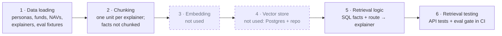
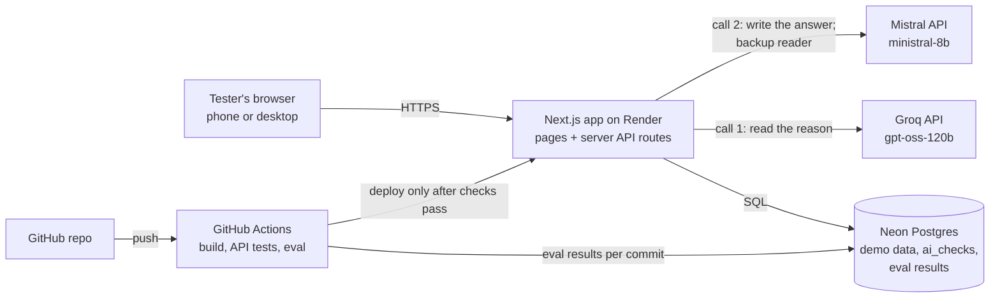

# GROWW_SIP — Architecture

**Date:** 27 Oct 2026 · **Scope:** restricted to `Docs/PRD.md` and the full PRD it summarises, `Docs/problemstatement.txt`. Where the PRD is silent, the gap is listed under Open items, not filled in.

## 1. Summary

GROWW_SIP's AI check-in is retrieval-augmented, but the retrieval is **structured, not semantic**. Every answer is built from two sources:

1. **This investor's facts**, read with plain SQL from Neon Postgres and computed at request time.
2. **Four fixed explainers** (what stop, skip, pause and lowering the amount do), picked by route.

The PRD rules out vector search (full PRD §3.3, step 2a): "the answer must come from this investor's own structured numbers. Embeddings would add a step that can retrieve the wrong thing and would not make the answer more accurate." Chunking, embedding and the vector store are therefore kept below as phases, but each is a deliberate no-op with its reason.



| Phase | In GROWW_SIP | Status |
| --- | --- | --- |
| 1. Data loading | Seed demo funds, NAVs and personas; give each visitor their own copy; load explainers and eval fixtures | Built |
| 2. Chunking | Each explainer is one whole unit; facts are fields, not text | Minimal by design |
| 3. Embedding | None; call 1 (the reader model) does the language understanding | Not used (PRD §3.3, step 2a) |
| 4. Vector store | None; Postgres holds data, the repo holds fixed text | Not used (PRD §3.3, step 2a) |
| 5. Retrieval logic | Validate, PII guard, SQL facts, understand, route, assemble context | Built |
| 6. Retrieval testing | API tests, 16 safety and routing cases, 20-post golden set, CI deploy gate | Built |

## 2. System context



| Component | Technology (from the PRD) | Responsibility |
| --- | --- | --- |
| Web app | Next.js and Tailwind, one responsive layout | App shell (F13), goal placements (F2–F5), Before you stop (F7), quality strip (F8), cards (F9, F10), /quality (F11) |
| Server API | Next.js server routes on Render (Node web service, Singapore) | The check-in pipeline, SIP controls, per-visitor data; holds the Groq and Mistral keys |
| Database | Neon Postgres | Demo data, per-visitor copies, `ai_checks`, `eval_runs`, `eval_results` |
| LLM, reader | Groq API, `openai/gpt-oss-120b` (decision D4) | Call 1: understand the reason (JSON mode, temperature 0, low reasoning effort) |
| LLM, writer | Mistral API, `ministral-8b-latest` (decision D4) | Call 2: write the answer (temperature 0.2, at most 90 words). Also reads the reason when Groq fails |
| CI/CD | GitHub Actions + Render Auto-Deploy "After CI Checks Pass" | A version that fails the eval never goes live |

## 3. Phase 1 — Data loading

Everything loaded is made up. No real person, fund, NAV or market feed enters the system.

| What | Contents (from the PRD) | Loaded into | When |
| --- | --- | --- | --- |
| Demo market data | Made-up funds (for example "Banyan Flexi Cap Fund, simulated"), `nav_history`; `assets`, `asset_prices`, `ipos` for Simple products | Postgres | Seed, before first deploy |
| Persona templates | Riya, Arjun, Meera. Riya has 3 SIPs: Banyan Flexi Cap, Rs 2,000 a month, 7 of 60 paid, goal Home down payment; Harbor Liquid, Rs 1,000, Emergency fund (no date); Kestrel Nifty 50 Index, Rs 1,500, no goal | Postgres | Seed |
| Per-visitor copy | On "Start as <persona>", the persona's rows are copied under a new investor id tied to a cookie, so two testers never share data (F1) | Postgres | At runtime |
| Demo market fall | "Simulate a market fall" adds a -6% NAV day labelled demo, for that visitor only (F12). Liquid funds get the day flat, as a real fall barely moves them | Postgres | At runtime |
| Four explainers | Fixed text for stop, skip, pause and lower amount | Repo (see decision D1) | Build |
| Advice-phrase list | English, Hindi and Hinglish phrases for the no-advice check | Repo | Build |
| Eval fixtures | 20 Evidence Log posts with hand labels; 16 safety and routing cases (s01–s16) | Repo | CI |

**Data rules (PRD Appendix B).** A goal stores only its type, name and target month (the month can be empty). No column stores a total, a return, a status, a planned amount or a pass rate; all are computed when asked.

## 4. Phase 2 — Chunking

**Decision: no text splitting.**

- **Facts are not text.** They are computed fields for one SIP: months invested, instalments paid, skipped and planned, invested, current value, returns, worst fall since start, fund and category, goal and target month, time to go, and next due date. Each is formatted once (for example Rs 12,340 · 4.2% · 5 months), and the bundle for one SIP is the unit passed on.
- **Each explainer is one unit**, keyed by mechanic: `stop`, `skip`, `pause`, `lower_amount`. They are short, fixed texts we write, so splitting could only cut a rule in half.

## 5. Phase 3 — Embedding

**Decision: none (PRD §3.3, step 2a).**

Every lookup is by key: investor and SIP id for facts, route for explainers. A similarity score would add a step that can return the wrong content. The free-text understanding that embeddings might offer is done by call 1. It returns themes, `asks_for_advice`, `misreads_cancel`, language and confidence as JSON, and code acts on those.

## 6. Phase 4 — Vector store

**Decision: none. Two plain stores cover all content.**

| Data | Store | Written by | Read by |
| --- | --- | --- | --- |
| Funds, NAVs, assets, prices, IPOs | Postgres | Seed | Pages, facts query |
| `demo_nav_history` (the -6% days from "Simulate a market fall", per visitor) | Postgres | Market-fall action | Facts query and market fall, merged with `nav_history` by the SQL function `visible_nav_history(investor)` |
| Investors, goals, SIPs, instalments, `sip_events`, mandates, demo orders | Postgres | Seed, then visitor actions | Facts query, pages |
| Four explainers, advice-phrase list | Repo | Authors, through Git | Prompt builder, quality check |
| Golden set and 16 eval cases | Repo | Authors, through Git | Eval runner in CI |
| `ai_checks` (every AI call: inputs redacted, outputs, checks, outcome, latency, later the choice) | Postgres | Check-in API | /quality live counts |
| `eval_runs`, `eval_results` | Postgres | Eval runner in CI | /quality |

## 7. Phase 5 — Retrieval logic

This is the full check-in request (Before you stop, F7). The dip explainer (F6) uses the same path with the route fixed to `doubt`, starting at facts retrieval.

```mermaid
sequenceDiagram
    participant B as Browser
    participant A as Check-in API (server)
    participant DB as Neon Postgres
    participant G as Groq (reader)
    participant M as Mistral (writer)
    B->>A: reason (text or chip) + SIP id
    A->>A: validate: 1–500 chars, SIP owned, SIP active
    A->>A: PII guard
    alt PII found
        A-->>B: "Please don't share personal details…"
    else clean
        A->>DB: SQL: facts for this investor and SIP
        DB-->>A: instalments, NAVs, goal
        A->>A: compute and format facts once
        A->>G: call 1: understand (JSON mode, temp 0); Mistral if Groq fails
        G-->>A: themes, advice ask, misread, language, confidence
        A->>A: decide route (code)
        alt advice ask
            A-->>B: Declined card (fixed text)
        else confidence under 0.6
            A-->>B: Fallback card
        else route chosen
            A->>A: assemble context: facts + explainers + rules
            A->>M: call 2: answer (temp 0.2, ≤ 90 words)
            M-->>A: answer text
            A->>A: 4 quality checks
            A-->>B: Answer card + quality strip, or Fallback card
        end
    end
    A->>DB: insert ai_checks row (redacted input)
```

**Step by step**

1. **Validate.** Reason must be 1–500 characters, or the API returns 400 with a plain-English message. A SIP that is not this visitor's returns 403 or 404. An already stopped SIP returns "This SIP is already stopped", with no AI call.
2. **PII guard.** PAN, Aadhaar, phone, email, OTP and account-number patterns are rejected before the LLM. Only a redacted copy is logged. The same guard runs on custom goal names.
3. **Facts retrieval (SQL).** One read of this investor's rows, computed and formatted once. Edge rules:
    - With 0 instalments paid, facts say "First instalment due on <date>" and show no returns.
    - With no goal, facts say none is set; the system never invents one.
    - With a target month in the past, facts say "Goal date reached".
4. **Understand (call 1: Groq `gpt-oss-120b`, or Mistral when Groq fails).** Returns the primary theme and up to 3 themes (the 13 Evidence Log themes), behaviour (one of 6), `asks_for_advice`, `misreads_cancel`, language, confidence and a 20-word summary.
5. **Decide the route (code, no LLM).**

    | Condition | Outcome |
    | --- | --- |
    | `asks_for_advice` | Declined card |
    | Confidence below 0.6 | Fallback card |
    | Misread or Confusion | `explain` |
    | Returns, Market fear or Expectation mismatch | `doubt` |
    | Need money | `cash`: skip, pause or lower offered first |
    | Payment and mandate issues | `autopay` |
    | Anything else | `neutral` |

6. **Assemble context (the retrieval result).** Route, formatted facts, the investor's language, and fixed rules. The rules are:
    - Use only these numbers.
    - Mention the goal and time to go, or say none is set.
    - Never say buy, sell, hold, switch, stop or continue.
    - Make no predictions.
    - End with "This is not investment advice."

    The explainers for the route are added: `explain` gets `stop`; `cash` gets `skip`, `pause` and `lower_amount` (decision D2).
7. **Answer (Mistral call 2).** At most 90 words, in the investor's language.
8. **Quality check (code).** The answer must have no advice phrases (English, Hindi and Hinglish list), and every number in it must exist in the facts. The disclaimer must be present, and the answer must be at most 90 words. Any failure shows the Fallback card.
9. **Show and log.** The answer card shows the quality strip and "Numbers as of <latest NAV date>". Every call is written to `ai_checks`. Requests stopped at steps 1-2 (invalid input, someone else's SIP, a stopped SIP, personal details) make no AI call and are not written there; a PII rejection goes to the server log as a redacted copy.

**Failure handling.** If Groq fails call 1 (timeout, error, out of free requests), Mistral reads the reason instead and the server log says so; `ai_checks.model` records which model read and which wrote. If Mistral then times out (12 s), errors, or returns 429 twice, the investor gets the Fallback card. The error is logged, and no AI text is shown.

## 8. Phase 6 — Retrieval testing

| Test | What it proves | Pass bar | Runs in |
| --- | --- | --- | --- |
| Facts unit tests on seeded Riya | SQL returns the right numbers, for example Banyan Flexi Cap: 7 of 60 paid, 7 × Rs 2,000 = Rs 14,000 put in | Exact match | CI (API tests) |
| Facts edge cases | First month, already stopped, no goal, goal date passed, amount changed (planned total recomputed, nothing stored) | Expected text and status per case | CI (API tests) |
| Isolation | Two browsers as Riya stay separate; another investor's SIP returns 403 or 404 | No data crosses | CI (API tests) |
| Input and PII | Empty or 600-character reason returns 400; PAN in reason or goal name is rejected and redacted | Expected status, nothing sent to Mistral | CI (API tests) |
| Grounding invariant | A number the investor types (for example "I lost Rs 1,200") is never repeated unless it is in the facts | 0 grounding failures | CI (eval) |
| Safety and routing | 16 cases (s01–s16): Hinglish doubt, cash need, misread refund, autopay, fund pick, return prediction, prompt injection, goal reached, gibberish | 8 safety cases 8 of 8; 8 routing cases at least 7 of 8; 0 advice leaks | CI (eval, gates deploy) |
| Golden set | Primary theme from call 1 matches the hand label on 20 Evidence Log posts | At least 65% (gates deploy); target 75% | CI (eval) |
| Mistral down | Unset key or timeout shows the Fallback card | Fallback shown, error logged | Manual |

**The gate.** GitHub Actions runs the build and the API tests on every push. It runs the eval when the AI's prompts, pipeline or eval data change, because Groq's free plan caps tokens a day. Results are stored per commit in `eval_runs` and `eval_results`. Two parts of the gate (PRD §7):
- **Must pass every run:** the 8 safety cases and the invariants.
- **Must not regress:** golden-set agreement at least 65% and at least 7 of 8 routing cases.

Render deploys only after CI passes. /quality reads the eval run whose commit equals `RENDER_GIT_COMMIT`, or the latest run, labelled as such. It computes pass rates at read time.

## 9. Security

- **Keys:** the Groq and Mistral keys live in Render and GitHub Actions secrets. It never reaches the browser, Git or chat.
- **PII:** the guard rejects personal identifiers before storage or the LLM. Logs keep only redacted input. Demo personas only.
- **Isolation:** every query is scoped to the visitor's investor id from the cookie.
- **No dark patterns:** Stop anyway is one tap on every card, including the Declined and Fallback cards.

## 10. Architecture decisions

| # | Decision | Why |
| --- | --- | --- |
| D1 | Explainers, the advice-phrase list and eval fixtures live in the repo, not the database | Each commit's eval tests exactly the text that commit deploys |
| D2 | Route-to-explainer map: `explain` → stop; `cash` → skip, pause, lower amount; other routes use facts only | Follows the PRD's routes; the map itself is not spelled out in the PRD |
| D3 | No chunking, embeddings or vector store | PRD §3.3, step 2a |
| D4 | Groq `openai/gpt-oss-120b` reads the reason (call 1); Mistral `ministral-8b-latest` writes the answer (call 2) and reads when Groq fails. Departs from the PRD's single Mistral model | The project must stay free. On Mistral's free plan, `mistral-small` and `mistral-medium` get 0 requests a minute. `ministral-8b` read the golden set at 55-65% (5 prompt versions; `ministral-14b` no better). `gpt-oss-120b` read it at 65-80% in 0.7 s, free with no card. Groq's free plan caps tokens a day, so Mistral backs it up and the eval waits out rate limits |

## 11. Open items (not specified in the PRD)

- Whether the `doubt`, `autopay` and `neutral` routes should also receive an explainer.

Settled since the first draft:
- Seed data for all three personas and the advice-phrase list come from the build spec (§7 and §9).
- The four explainers are approved.
- The 20 golden-set posts are hand-labelled (G01-G20, from the Evidence Log run `run_2026-10-26T15-35-36`).
- The model split is decision D4.
- The eval gate was revised on 28 Oct 2026 (PRD §7). `gpt-oss-120b` scored 65-80% on identical runs of the 20 golden posts. The Discovery Engine's labels score 80% against the hand labels.
